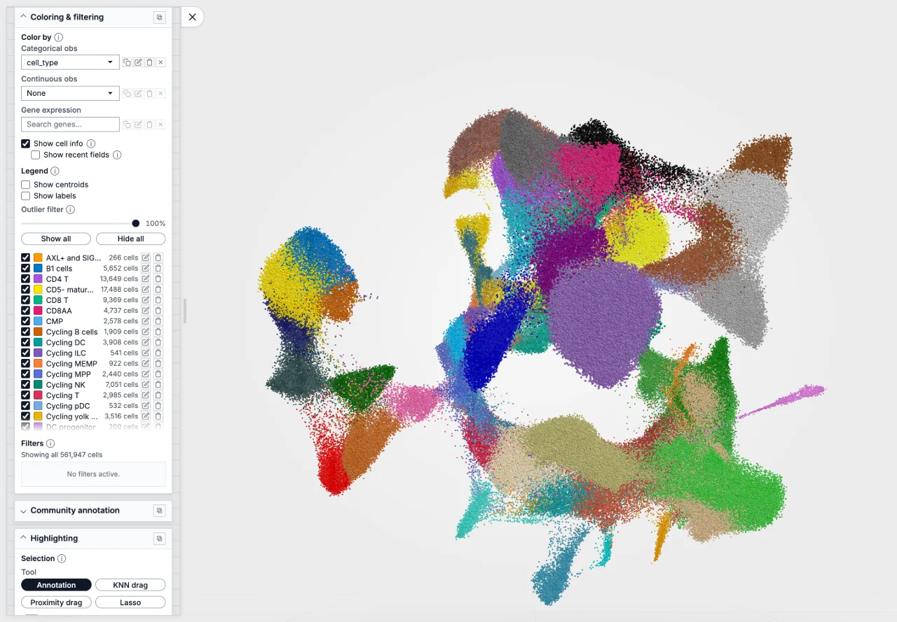
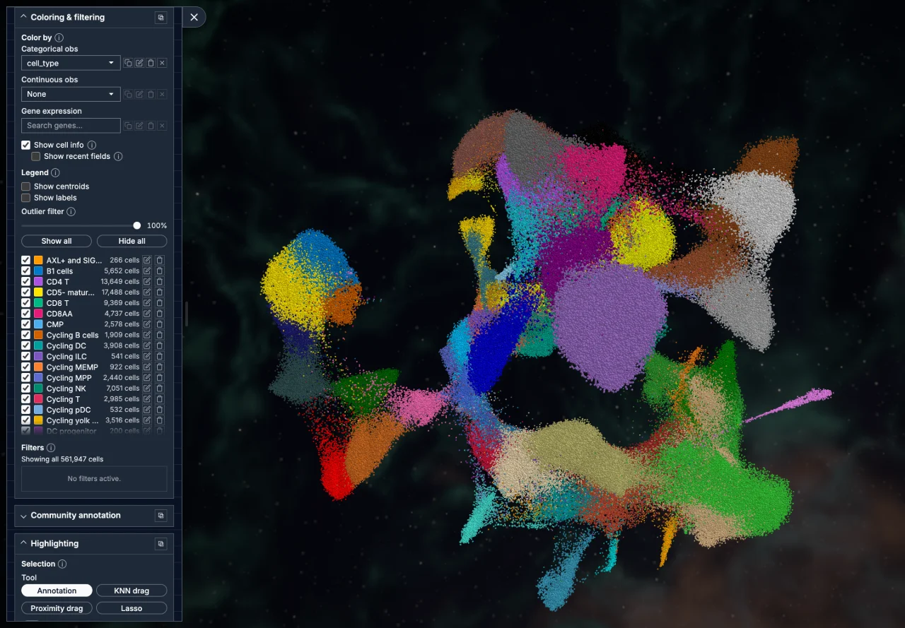
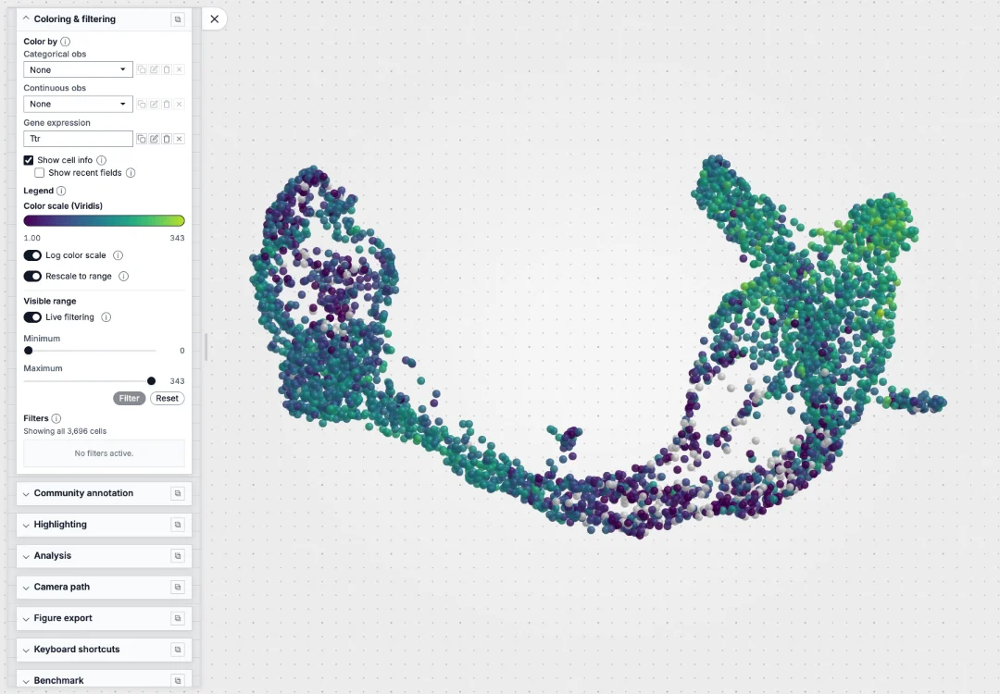
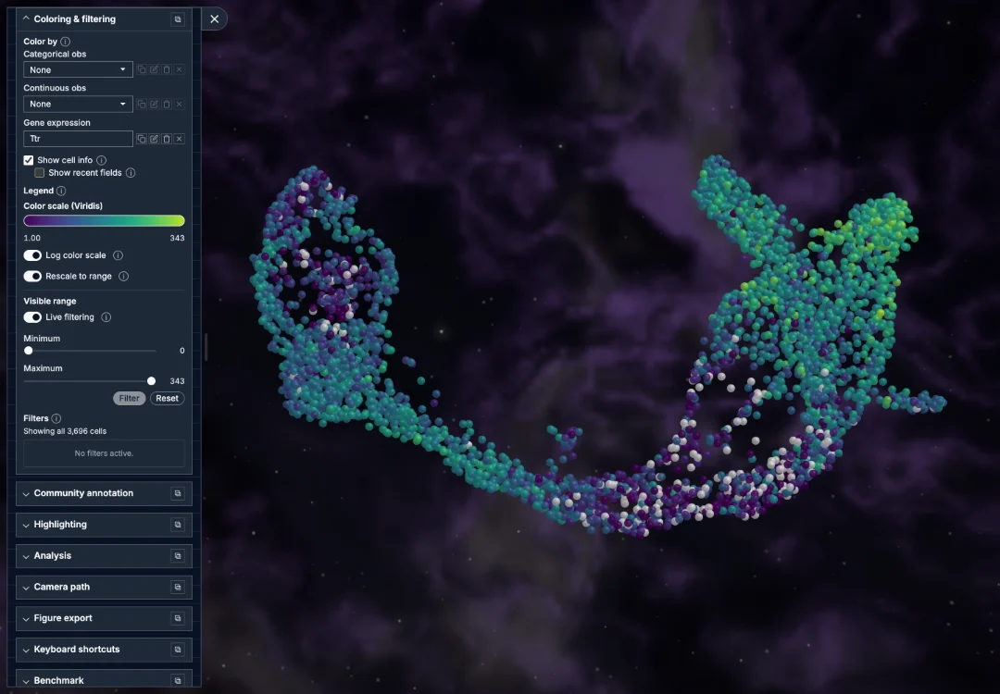
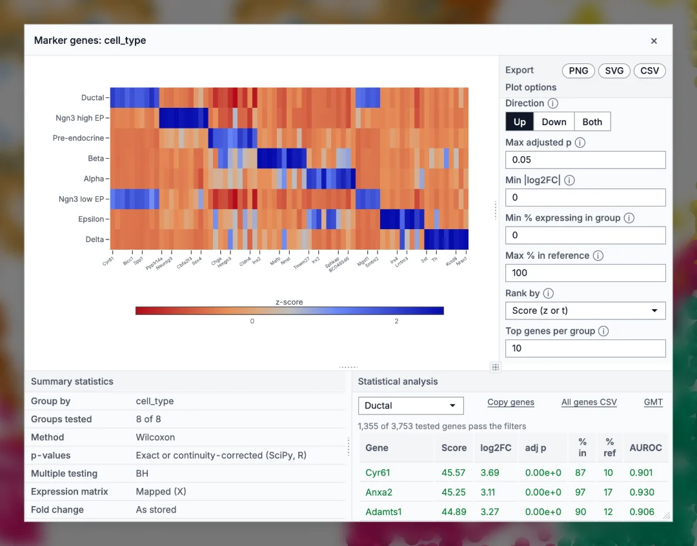
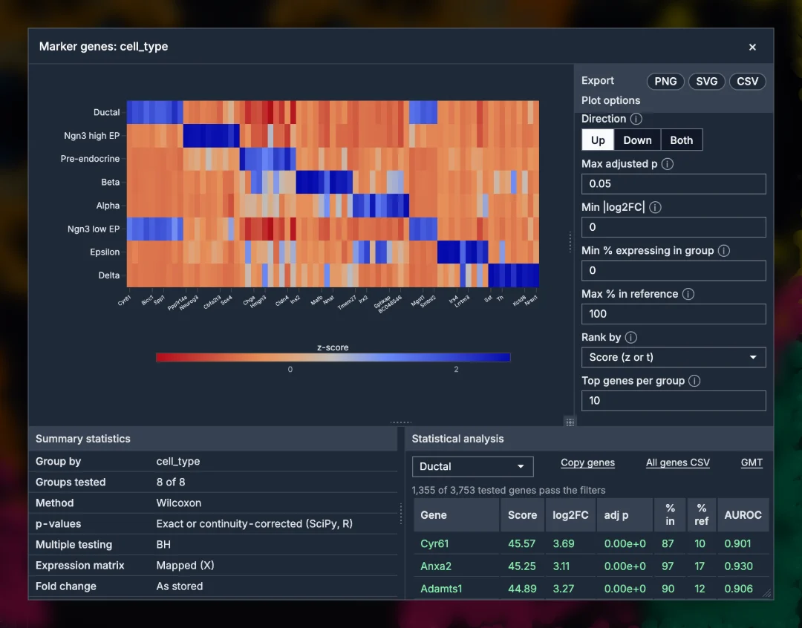
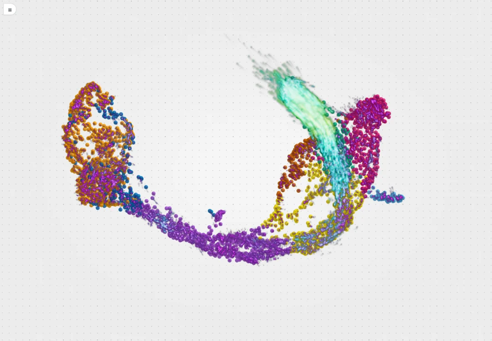
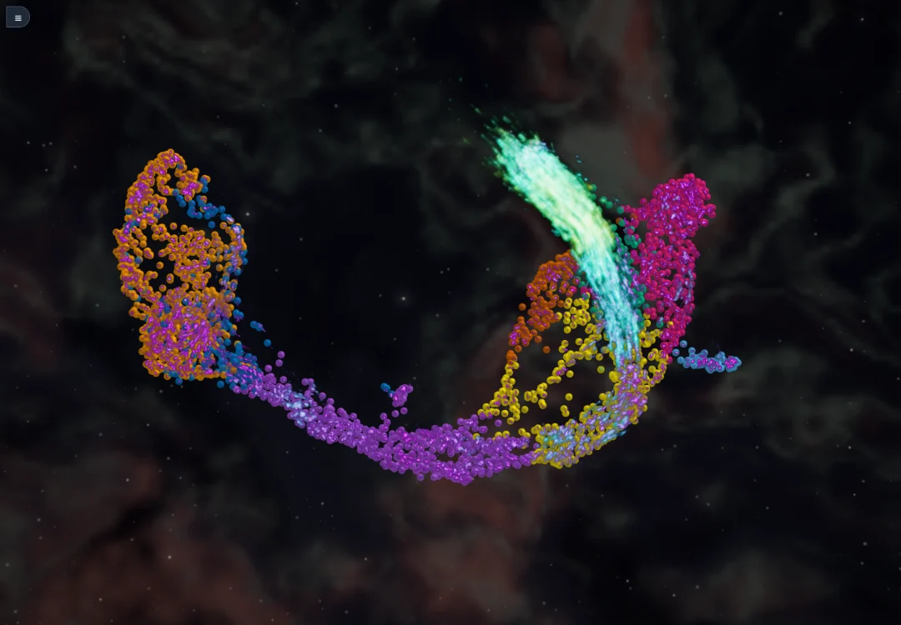
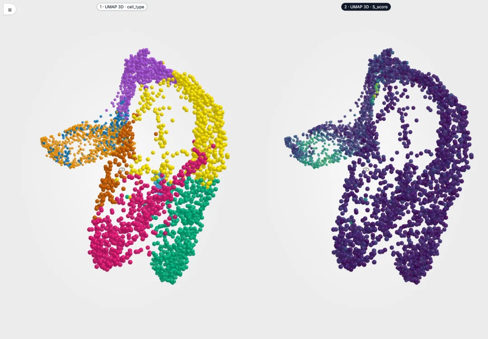
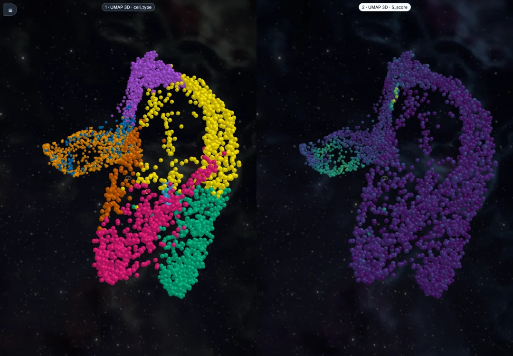

# Cellucid

<!-- The home page. Its look lives in `_static/home.css` (every rule scoped to
     the `cl-` classes used here), and every image is a WebP the screenshot tool
     emits from the `home-*` scenarios in `_tooling/screenshots/scenarios.mjs`,
     with its provenance in `captures.json`. -->

````{container} cl-hero

```{raw} html
<p class="cl-hero-tagline">See every cell. <span>Keep the biology in view.</span></p>
<p class="cl-hero-lead">A GPU-accelerated single-cell viewer that runs in your
browser. Move through hundreds of thousands of cells in 1D, 2D and 3D, colour
them by any gene, compare populations, and leave with a figure, a saved session
or a link. Nothing to install: your files are read in place, never uploaded.</p>
```

:::{container} cl-hero-actions

```{button-link} https://www.cellucid.com
:color: primary

{octicon}`link-external;1em;sd-mr-1` Open Cellucid
```

```{button-ref} user_guide/web_app/a_orientation/03_quick_tour_60_seconds
:ref-type: doc
:color: secondary
:outline:

Take the 60-second tour
```

:::

:::{container} cl-formats

**Opens** {bdg-primary}`AnnData .h5ad` {bdg-primary}`AnnData Zarr`
{bdg-secondary-line}`MuData` {bdg-secondary-line}`Loom`
{bdg-secondary-line}`10x Cell Ranger` {bdg-secondary-line}`MatrixMarket`
{bdg-secondary-line}`Seurat · SingleCellExperiment .rds`
{doc}`What Cellucid reads <user_guide/web_app/b_data_loading/07_file_format_expectations>`

:::

```{raw} html
<figure class="cl-hero-shot">
  <div class="cl-hero-frame">
    
    
  </div>
  <figcaption>The developing human immune system atlas (Suo), all 561,947
  cells in a 3D UMAP, coloured by cell type. It is one of the built-in
  samples: open Cellucid and it is the first thing you see.</figcaption>
</figure>
```

````

## Three ways in

::::{grid} 1 1 3 3
:gutter: 3
:class-container: cl-ways

:::{grid-item-card} {octicon}`browser;1.25em;sd-mr-2` Web app
:link: user_guide/web_app/index
:link-type: doc

Open the app, pick a sample, or drop in your own file or folder. Everything
runs in the browser.
+++
Web app guide {octicon}`arrow-right;1em`
:::

:::{grid-item-card} {octicon}`package;1.25em;sd-mr-2` Python
:link: user_guide/python_package/index
:link-type: doc

`pip install cellucid`. Prepare a Cellucid-ready AnnData, serve files from a
workstation or cluster, and keep the viewer beside your notebook.
+++
Python guide {octicon}`arrow-right;1em`
:::

:::{grid-item-card} {octicon}`beaker;1.25em;sd-mr-2` R
:link: user_guide/r_package/index
:link-type: doc

View a Seurat or SingleCellExperiment object in RStudio or Positron, or write
the same Cellucid-ready AnnData from it.
+++
R guide {octicon}`arrow-right;1em`
:::

::::

## What you can do

::::{grid} 1 1 2 2
:gutter: 3
:class-container: cl-features

:::{grid-item-card}
:link: user_guide/web_app/d_fields_coloring_legends/index
:link-type: doc
:class-card: cl-feature
:class-header: cl-feature-media

```{raw} html


```
^^^
**Colour by any gene or field**

Search every gene in the file, or colour by any `obs` column, with legends you
can filter from.
:::

:::{grid-item-card}
:link: user_guide/web_app/h_analysis/index
:link-type: doc
:class-card: cl-feature
:class-header: cl-feature-media

```{raw} html


```
^^^
**Analyse what you selected**

Differential expression between the groups you highlighted, marker genes, dot
plots and gene signatures, next to the embedding.
:::

:::{grid-item-card}
:link: user_guide/web_app/i_vector_field_velocity/index
:link-type: doc
:class-card: cl-feature
:class-header: cl-feature-media

```{raw} html


```
^^^
**See where cells are going**

Animate RNA velocity or any other vector field as particles that flow over the
embedding, in 2D or 3D.
:::

:::{grid-item-card}
:link: user_guide/web_app/c_core_interactions/04_view_layout_live_snapshots_small_multiples
:link-type: doc
:class-card: cl-feature
:class-header: cl-feature-media

```{raw} html


```
^^^
**Compare views side by side**

Keep a view, recolour the next, and link their cameras so one gesture moves
both.
:::

::::

::::{grid} 1 2 3 3
:gutter: 2
:class-container: cl-capabilities

:::{grid-item-card} {octicon}`filter;1.1em;sd-mr-2` Filter
:link: user_guide/web_app/e_filtering/index
:link-type: doc

Hide categories, set value ranges and drop outliers, and see the count as you go.
:::

:::{grid-item-card} {octicon}`pencil;1.1em;sd-mr-2` Highlight
:link: user_guide/web_app/f_highlighting_selection/index
:link-type: doc

Lasso, click or drag through the neighbour graph to build named groups of cells.
:::

:::{grid-item-card} {octicon}`bookmark;1.1em;sd-mr-2` Save and share
:link: user_guide/web_app/l_sessions_sharing/index
:link-type: doc

A session file restores the whole view; a link opens the same dataset for anyone.
:::

:::{grid-item-card} {octicon}`image;1.1em;sd-mr-2` Export figures
:link: user_guide/web_app/k_figure_export/index
:link-type: doc

SVG and PNG figures of exactly what is on screen, with their provenance.
:::

:::{grid-item-card} {octicon}`people;1.1em;sd-mr-2` Annotate together
:link: user_guide/web_app/j_community_annotation/index
:link-type: doc

Propose labels, vote and reach consensus through a GitHub repository.
:::

:::{grid-item-card} {octicon}`shield-check;1.1em;sd-mr-2` Private by design
:link: user_guide/web_app/o_accessibility_privacy_security/index
:link-type: doc

Files are read where they are and never uploaded to Cellucid; see what is stored and sent.
:::

::::

## Start with the question in front of you

You do not need to learn the whole application before doing useful work. Pick
the route that matches today’s question.

::::{grid} 1 2 2 2
:gutter: 3

:::{grid-item-card} Where are my populations?
:link: user_guide/web_app/d_fields_coloring_legends/index
:link-type: doc

Colour by a categorical `obs` field or a marker gene, then filter the noise
away and highlight a population without losing the surrounding context.
:::

:::{grid-item-card} Where are cells going?
:link: user_guide/web_app/b_data_loading/10_standard_pancreas_dataset
:link-type: doc

Open the real Pancreas sample, compare its 1D, 2D, and 3D embeddings, and
inspect the dimension-matched RNA-velocity overlay.
:::

:::{grid-item-card} How do I share my own data?
:link: user_guide/web_app/b_data_loading/11_custom_dataset_repository
:link-type: doc

Build a small public catalog with stable dataset identities, test it locally,
and share an exact URL that opens the intended dataset.
:::

:::{grid-item-card} Can the viewer stay beside my analysis?
:link: user_guide/web_app/b_data_loading/05_jupyter_tutorial
:link-type: doc

Embed Cellucid in Jupyter, inspect connection health, exchange selections and
state with Python, and stop the local viewer cleanly.
:::

::::

## Bring data in the way that fits the work

| What you have | Best first path | Why |
|---|---|---|
| An H5AD of any size, a Zarr folder, or a portable Zarr ZIP | {doc}`Browser file picker <user_guide/web_app/b_data_loading/03_browser_file_picker_tutorial>` | One direct local selection or drop, no Python installed |
| A Seurat or SingleCellExperiment `.rds`, a Loom, 10x or MatrixMarket output, or a MuData | {doc}`What Cellucid reads <user_guide/web_app/b_data_loading/07_file_format_expectations>` | Opened as it is, from disk or a link: no conversion first |
| An H5AD or Zarr store on another machine | {doc}`Python server <user_guide/web_app/b_data_loading/04_server_tutorial>` | The browser reads it in place, over an SSH tunnel if needed |
| An in-memory `AnnData` object | {doc}`Jupyter integration <user_guide/web_app/b_data_loading/05_jupyter_tutorial>` | A tight analysis-to-visualization loop |
| A public collection of datasets | {doc}`Custom repository guide <user_guide/web_app/b_data_loading/11_custom_dataset_repository>` | No running server; exact catalog and share links |
| A static host or CDN you already control | {doc}`Publish a dataset catalog <user_guide/web_app/b_data_loading/02_local_demo_tutorial>` | `?data=` opens your catalog from one link; `?sampleCatalog=` fills the app's own **Sample dataset** dropdown from it |

The {doc}`complete data-loading map
<user_guide/web_app/b_data_loading/01_loading_options_overview>` explains the
memory, network, privacy, and reproducibility tradeoffs before you commit to a
path.

## Learn at your own depth

::::{grid} 1 2 3 3
:gutter: 2
:class-container: cl-capabilities

:::{grid-item-card} {octicon}`rocket;1.1em;sd-mr-2` 60-second tour
:link: user_guide/web_app/a_orientation/03_quick_tour_60_seconds
:link-type: doc

Enter, move, colour, keep a view, highlight and export, once each.
:::

:::{grid-item-card} {octicon}`git-branch;1.1em;sd-mr-2` Which workflow?
:link: user_guide/web_app/a_orientation/05_which_workflow_is_for_me_decision_tree
:link-type: doc

A short decision tree from the data you have to the route that fits.
:::

:::{grid-item-card} {octicon}`mortar-board;1.1em;sd-mr-2` Tutorials
:link: user_guide/python_package/f_notebooks_tutorials/index
:link-type: doc

Notebooks from a first coloured embedding to velocity and session round trips.
:::

:::{grid-item-card} {octicon}`book;1.1em;sd-mr-2` UI glossary
:link: user_guide/web_app/a_orientation/04_ui_glossary_terminology
:link-type: doc

Every term the app uses, defined once.
:::

:::{grid-item-card} {octicon}`code;1.1em;sd-mr-2` API reference
:link: user_guide/python_package/g_api_reference_coverage/index
:link-type: doc

The Python API, function by function, with exact contracts.
:::

:::{grid-item-card} {octicon}`tools;1.1em;sd-mr-2` Troubleshooting
:link: user_guide/web_app/q_troubleshooting_index/index
:link-type: doc

From the message you saw, or the symptom, to the fix.
:::

::::

## Open source, citable, built in the open

::::{grid} 1 1 2 2
:gutter: 3
:class-container: cl-community

:::{grid-item-card} {octicon}`quote;1.25em;sd-mr-2` Cite Cellucid
:link: citing
:link-type: doc

If Cellucid helps your work, here is the reference to cite, and the study to
cite for each built-in sample.
:::

:::{grid-item-card} {octicon}`heart;1.25em;sd-mr-2` Contribute
:link: contributing
:link-type: doc

Report an issue, improve a guide or add a feature. The code is BSD-3-Clause
licensed and developed in the open.
:::

::::

Cellucid is one product in a few repositories, with clear handoffs:

- [cellucid](https://github.com/theislab/cellucid) is the web application.
- [cellucid-python](https://github.com/theislab/cellucid-python) writes
  Cellucid-ready AnnData and MuData, serves every format the viewer reads, and
  embeds the viewer in notebooks.
- [cellucid-r](https://github.com/theislab/cellucid-r) views Seurat and
  SingleCellExperiment objects from R and writes the same Cellucid-ready
  AnnData.
- [cellucid-datasets](https://github.com/theislab/cellucid-datasets) hosts the
  public sample catalog, including the standard Pancreas dataset.
- [cellucid-demo-custom-datasets](https://github.com/theislab/cellucid-demo-custom-datasets)
  is a tiny, inspectable model for your own public catalog.
- [cellucid-annotation](https://github.com/theislab/cellucid-annotation)
  provides the repository contract for community annotation.

```{toctree}
:maxdepth: 2
:hidden:
:caption: Sections

Web app <user_guide/web_app/index>
Python <user_guide/python_package/index>
R <user_guide/r_package/index>
contributing
changelog
citing
```
